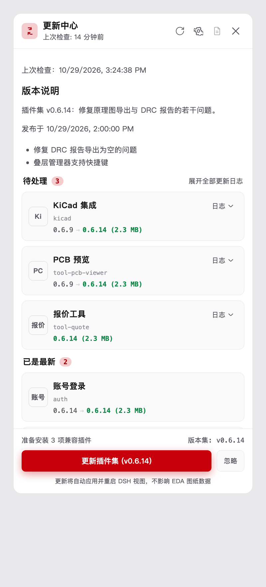
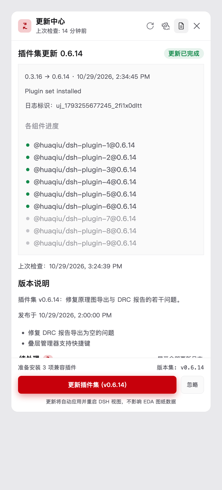
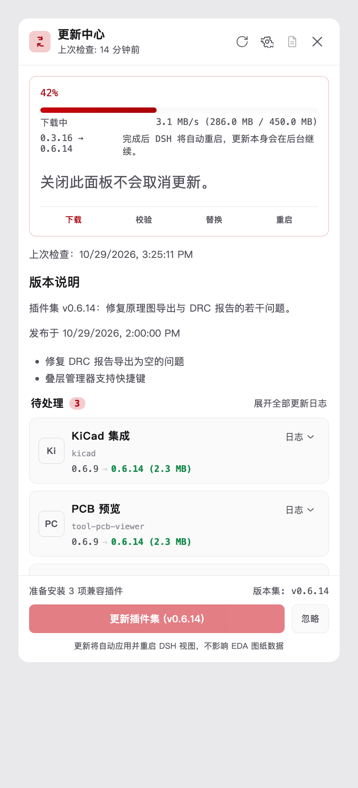
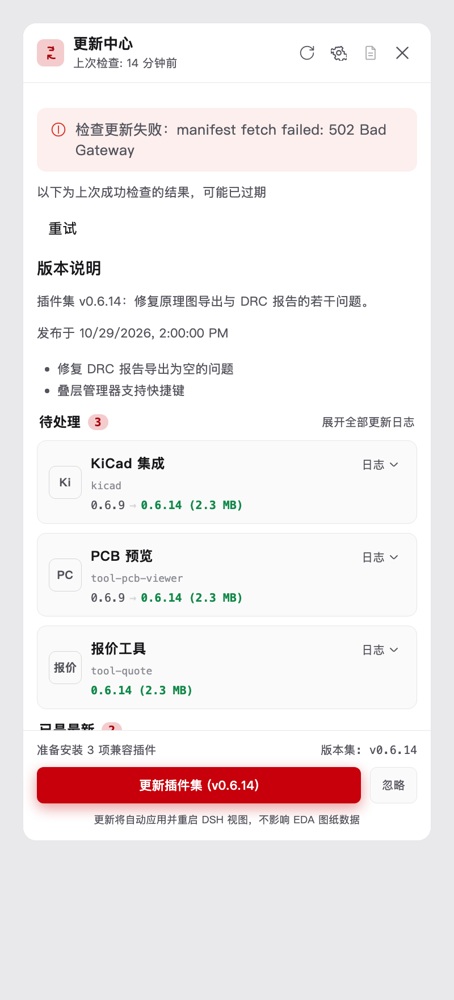
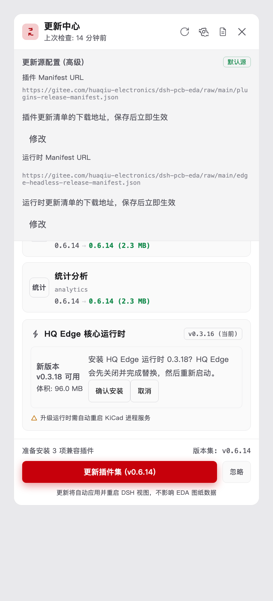
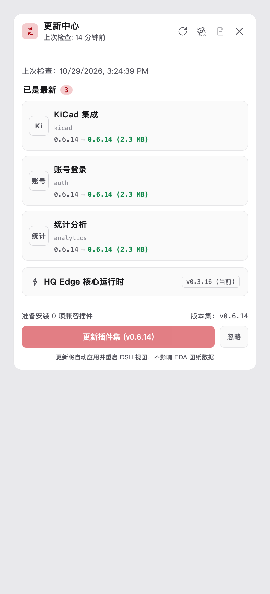

# Plugin Update — Workflow, UI & UX Baseline

**Status:** baseline study for the next UI/UX pass — **no product code was changed**
**Date:** 2026-10-29
**Scope:** `packages/dsh-tool-plugin-update` (browser + node halves) and the hq-edge API it forwards to
**Evidence:** source with `file:line` citations, the package's 102 unit tests, and six panel states rendered from the real view code (§5.2)

---

## 0. TL;DR for whoever picks up the redesign

| # | Fact | Where |
|---|---|---|
| 1 | One surface only: a sidebar row → a **360 px × ≤720 px modal**. No page, no tabs, no deep link. | `client/index.ts:957` |
| 2 | The body is **one flat scroll column**: last-job log → check banner → release notes → 3 plugin groups → runtime card → toast host. | `client/update-view.ts:1403` |
| 3 | The panel is a **thin adapter**: every decision (discovery, compatibility, ignore, install, restart) is hq-edge's. | `src/index.ts:10-20` |
| 4 | The count the badge shows is **actionable plugin items + 1 runtime offer** — nothing else. | `client/badge.ts` |
| 5 | Two different things are called "log": the per-card changelog (`日志`) and the job log (header button). | `update-view.ts:219`, `:1383` |
| 6 | The active-update card **renders without its title** — a live defect (§6.2 #1). | `update-view.ts:416-427` |
| 7 | A failed check leaves the primary install button **enabled on stale data**. | `update-view.ts:1292` |
| 8 | ~20 copy keys and ~12 CSS classes are already dead; two of them encode a superseded design. | §6.5 |

**Top 5 moves, in order:** fix the active card → give the body a decision-first hierarchy → make the footer reactive (it is currently static text + a permanently red CTA) → demote "已是最新" and drop the `0.6.14 → 0.6.14` rows → unify vocabulary and type scale.

---

## 1. The feature in one paragraph

`@huaqiu/dsh-tool-plugin-update` adds one row to the DSH sidebar ("插件更新") and one modal behind it ("更新中心"). The row carries a count badge and, while an update runs, an inline progress suffix. The modal reviews what hq-edge found: the plugin set offered by the release manifest, the HQ Edge runtime offer, per-plugin changelogs, and two advanced manifest-source editors. Installing is an **accept-then-poll** transaction owned by hq-edge: the plugin only ever posts `{setVersion, pluginNames?}`, receives `202 {jobId}`, and re-renders from `GET /status` until the job settles. hq-edge restarts DSH (plugin set) or itself (runtime) to activate.

---

## 2. System map

```
browser — DSH Web UI
  sidebar row '插件更新' + badge(N)                       client/index.ts
    └─ click → modal '更新中心'
         └─ UpdateStore: report + active/recent jobs
              60 s idle refresh · 1 s poll → 5 s backoff (only while a job runs)
              └─ same-origin fetch  /api/v1/huaqiu/plugin-update/*

node half — DSH webServer prefix route                  src/routes.ts
  createUpdateForwarder: thin adapter, no update logic
  30 s budget per call · 600 s for /runtime-request · 405 on wrong method
    └─ loopback HTTP

hq-edge server
  routes/plugin-updates.ts → PluginUpdateService   (discovery, compat, ignore, install)
  PluginInstaller (download + verify + stage) → supervisor (activate) → DSH restart
  durable UpdateJobStore (active job + bounded recent history)
```

**Ownership boundary** (`src/index.ts:10-20`): the plugin holds no manifest, compatibility, download or install logic. Anything the UI shows about *what* to install comes from hq-edge; the plugin only decides *how to present* it and applies one defensive direction guard (SemVer) on top.

### 2.1 Endpoints the UI uses

| UI action | Plugin route | hq-edge route | Notes |
|---|---|---|---|
| open panel / idle | `GET /report` | `GET /api/v1/plugin-updates` | cached report |
| refresh button | `POST /check` | `POST …/check` | real discovery |
| — | `GET /status` | `GET …/status` | active job + recent |
| install (set or subset) | `POST /install` | `POST …/install` | `202 {jobId,state}`, 409 when busy |
| ignore release | `POST /ignore` | `POST …/ignore` | then `POST /check` |
| un-ignore release | `POST /unignore` | `POST …/unignore` | then `POST /check` |
| ignore one plugin | `POST /plugin-ignore` | `POST …/plugin-ignore` | then `POST /check` |
| show one plugin again | `POST /plugin-unignore` | `POST …/plugin-unignore` | then `POST /check` |
| runtime offer | (folded into report) | `GET …/runtime-update` | `updateAvailable` + `latest` |
| upgrade runtime | `POST /runtime-request` | `POST …/runtime-update/request` | 600 s budget; 202 then restart |
| edit manifest sources | `GET/POST /plugin-source`, `/runtime-source` | same upstream | override persisted per host |

---

## 3. Data model the UI renders

### 3.1 Report

```ts
PluginUpdateReport {
  manifestVersion: string | null      // the offered "set" version — gates every install
  checkedAt: string | null
  lastError: string | null            // discovery failed
  ignoredSet: boolean                 // whole release muted
  actionableCount: number             // recomputed client-side
  release?: { summary, notes[], breaking[], notesUrl, publishedAt }
  items: PluginUpdateItem[]
  runtime: { currentVersion, latest, updateAvailable, checkedAt, lastError, source, lastResult }
  pluginSource?: { url, origin, configuredUrl, override }
}
PluginUpdateItem { name, displayName, currentVersion|null, availableVersion, state,
                   changes?[], sizeBytes?, ignored?, blockedReason? }
state ∈ update | install | current | ignored | blocked
```

### 3.2 Job

```ts
UpdateJob { id, kind: plugin-set|runtime, targetVersion, previousVersion,
            phase, message?, progress{percent,bytesDone,bytesTotal,bytesPerSecond},
            steps?, result?, logHint?, startedAt, updatedAt }
```

| Phase | UI label (zh) | Rendered in |
|---|---|---|
| `queued` / `resolving` | 排队中 / 解析版本 | active card, step 0–1 |
| `downloading` | 下载中 | active card, step 0 |
| `verifying` | 校验完整性 | step 1 |
| `staging` | 暂存文件 | step 2 |
| `activating` | 启用插件集 | step 2 |
| `awaiting-host` | 等待主机替换运行时 | step 3 |
| `restarting` / `verifying-after-restart` | 正在重启 / 重启后校验 | step 3 |
| `done` | 已完成 | result card ("更新已完成") |
| `failed` / `rolled-back` / `abandoned` | 失败 / 已回滚 / 已中断 | result card + Retry |

Terminal phases: `done, failed, rolled-back, abandoned` (`api.ts:228`).

---

## 4. Workflows

### 4.1 Ambient (no panel open)

1. On mount (`client/index.ts:1900+`): inject CSS, resolve shell design tokens, build `UpdateStore`, mount the sidebar row after the Huaqiu family block, `refresh()` + `fetchStatus()`, start a 60 s idle refresh.
2. Badge re-renders on every store change: `badgeCountFor(report, activeJob)` — actionable plugin items + 1 if a runtime offer is present; a *running* job shows 1 when nothing is actionable; settled jobs contribute nothing.
3. Row label gains a suffix while a job runs: `插件更新 · 42%` (or the phase name when no percentage); tooltip repeats the phase.

### 4.2 Open & check

```
click row
  ├─ ensureDesignTokens()            // shell may publish tokens after mount
  ├─ fetchStatus()   (fire & forget) // resume an in-flight job BEFORE discovery
  ├─ openUpdateView()                // renders from whatever the store holds
  └─ check()         (fire & forget) // real discovery, re-renders behind the panel
```
A second click while open only re-shows the overlay (`update-view.ts:1327-1331`); it does not re-check.

### 4.3 Install the whole set

```
[更新插件集 (vX)]  →  POST /install {setVersion}
        │                 (button disabled + store.installing = true)
        ├─ 409 busy → toast '安装失败: <server english text>'
        ├─ 202 accepted → toast '更新已安装，正在重启 DSH…'   ← says "installed" at accept time
        └─ poll /status every ~1 s (→5 s backoff on error)
                 ├─ active job  → active card (progress, phase, steps, "关闭此面板不会取消更新")
                 └─ settled     → result card (previous→installed, steps, error code, Retry)
                                  + store re-reads /report so the list and badge drop to 0
```
A DSH restart follows; the panel disappears with the page.

### 4.4 Install a single plugin

Only reachable **inside a card's `日志` drawer** → `安装此插件` → `POST /install {setVersion, pluginNames:[name]}`. hq-edge and `PluginInstaller.stage(…, selectedNames)` do honour the subset. The tooltip, however, still claims it installs the whole set (`copy.ts:28`) — see §6.2 #5.

### 4.5 Ignore

| Level | Control | Effect |
|---|---|---|
| Whole release | footer `忽略` / `恢复提醒` | `ignoredSet = true`; every item drops out of the count |
| One plugin | card drawer `忽略` / `恢复提醒` | item state → `ignored`; stays visible in the 已忽略 group |

Both paths call `POST …ignore` **then `POST /check`**, because the cached report never re-classifies on its own.

### 4.6 Runtime update

```
[升级核心] → armed → [确认安装] → POST /runtime-request {targetVersion}
      → hq-edge re-reads manifest, downloads (100s of MB), verifies, stages  (up to 600 s)
      → 202 accepted → panel latches "已受理，正在重启" → hq-edge exits → EDA host swaps → relaunch
```
Failure of the *previous* attempt surfaces as an amber alert above the runtime card with a Dismiss action; success as a quiet green line.

### 4.7 Failure & retry surface

| Failure | Where the user sees it | Retry |
|---|---|---|
| discovery failed | red banner + "以下为上次成功检查的结果，可能已过期" + bare `重试` | `POST /check` |
| install rejected (409/500) | 4 s toast, English message body | click again |
| install job failed | result card (visible while log open, auto-opened for failures) | `重新尝试（发起新的更新）` (new job) |
| runtime failed / rolled back | amber alert above runtime card | `升级核心` again |
| forwarder timeout | toast `安装失败: hq-edge request timed out after 30000ms` | click again |

---

## 5. UI inventory

### 5.1 Surfaces and regions

| Region | Content | Notes |
|---|---|---|
| Sidebar row | pinwheel icon, label, count badge | badge turns into a corner dot in the collapsed rail |
| Header (sticky) | brand glyph, `更新中心`, `上次检查: N 分钟前`, toolbar: refresh · gear · **log toggle** · close | 4 icon buttons, 26 px squares |
| Settings strip | gear-toggled: 更新源配置 (高级) + origin badge + two manifest URL editors | `flex: none`, pushes the body down, not scrollable |
| Job block | active card **or** last-job result card + older jobs | result is behind the log toggle; failures auto-open |
| Check banner | `上次检查：<absolute time>` or failure banner + `重试` | duplicates the header's relative time |
| Release block | 版本说明, summary, 发布于, notes list, breaking banner, 发布说明 link | always visible, unbounded height |
| Plugin groups | 待处理 / 已忽略 / 已是最新, count pills, `展开全部更新日志` | blocked items are dropped entirely (`update-view.ts:1117`) |
| Card | avatar initials, display name, package name, `old → new (size)`, `日志` drawer | drawer holds changelog + per-plugin install/ignore |
| Runtime card | 核心运行时, current chip, `新版本 vY 可用`, 关键修复 tag, size+summary, `升级核心`, restart note | sits **below the fold** at default height with ≥4 plugins |
| Footer (sticky) | `准备安装 N 项兼容插件`, `版本集: vX`, primary CTA, `忽略`, footnote | CTA label repeats the version; always brand-red even when disabled |
| Toast host | last action result, 4 s | `role="status"` for errors too |

### 5.2 Rendered states

All six images come from the **real view code** (`openUpdateView` + the real CSS), rendered in jsdom and screenshotted in Chrome; see Appendix D to reproduce.

| | |
|---|---|
| **Default — 3 updates + runtime offer**<br> | **Last-update log opened via the header toggle**<br> |
| **Job running (42 %, downloading)**<br> | **Discovery failed — stale list kept**<br> |
| **Advanced open + runtime confirm armed**<br> | **All up to date**<br> |

What the plates show, spelled out:

- **01**: header says "14 分钟前", the body immediately repeats the absolute time; release notes take ~150 px; three update cards + a "已是最新 2" group fill the rest; the runtime card (which the badge counts) is **not visible** without scrolling; the footer repeats the set version twice.
- **02**: the log is a single 9-row list; installed rows are green dots, skipped rows grey; the only identifier is a raw `uj_…` string; no copy/log-file affordance.
- **03**: the active card shows `42%`, bar, phase + telemetry, then `0.3.16 → 0.6.14` beside the restart note, then "关闭此面板不会取消更新。" rendered at the panel base size — the largest text in the card. **The job title is missing entirely** (§6.2 #1).
- **04**: red banner + `重试` as bare text; the primary CTA stays fully enabled on stale data.
- **05**: the settings strip eats ~300 px; the runtime confirm prompt is squeezed into a ~150 px column next to the version block and wraps to four lines.
- **06**: with nothing to do, the panel still renders a large disabled red CTA and an enabled-looking `忽略`; every "current" card shows `0.6.14 → 0.6.14 (2.3 MB)`.

### 5.3 Component → behaviour table

| Component | Class | States | Interaction |
|---|---|---|---|
| Sidebar row | `.hqpu-sidebar-entry` | idle / hover / active / collapsed rail | click opens (never toggles closed) |
| Badge | `__badge` | count > 0 only | error-red pill; corner dot when collapsed |
| Icon button | `.hqpu-icon-btn` | default / hover / disabled / `aria-pressed` | 26 px target |
| Primary CTA | `.hqpu-btn--block` | enabled / disabled | no label change while installing |
| Ignore | `.hqpu-btn--ignore` | ignore / unignore | 10 px label |
| Package card | `.hqpu-card` | update / install / current / ignored | whole card is not clickable; only `日志` and the drawer's buttons are |
| Log toggle | `.hqpu-log-toggle` | closed / open | accordion, one per card, not `aria-expanded` |
| Log button (header) | `[data-log-toggle]` | disabled / pressed | `aria-pressed`, tooltip names the next action |
| Runtime card | `.hqpu-engine` | no offer / offer / armed / busy / accepted | arm→confirm, no undo other than 取消 |
| Source editor | `.hqpu-source-*` | read / editing / saving | save → re-check |
| Toast | `.hqpu-toast` | success / error | 4 s, replaces the previous one |

### 5.4 Tokens and type scale

- Every colour is a shell token (`--dsw-alias-*`), re-exported as `--hq-*` inside `.hqpu-panel` (`index.ts:930-955`); `ensureDesignTokens()` backfills the one token the bundled shell omits.
- Geometry: panel `min(360px, 100vw − 32px)` × `min(86vh, 720px)`; card radius 8 px; icon targets 26 px; primary CTA 32 px tall.
- Type sizes actually used: **9, 10, 11, 12, 12.5, 13, 14, 20 px** — 18 declarations at 10 px, 12 at 11 px, 9 at 9 px. Body copy is 10–11 px, i.e. below the 12 px floor most desktop UIs use for secondary text; the one line that renders at the panel's base size instead of the scale is the unstyled `.hqpu-job-meta` (§6.2 #2).

### 5.5 Copy and localisation

- 149 zh keys (en mirrors), resolved from `<html lang>` and re-resolved live; the sidebar row re-localises without a reload.
- ~20 keys are unreferenced (e.g. `viewIntro`, `viewInfo`, `installAll`, `installOne`, `nothingToInstall`, `ignoredOffer`, `groupCount`, `runtime.update`, `runtime.durationNote`, `runtime.elevation`, `job.speed/eta/nextDone`, `release.changesTitle`, `ui.saveAndRefresh`, `ui.pendingTitle`). Two of them describe a *previous* information architecture (`installAll`, `installOne`).
- Server-originated strings cross into the UI untranslated: `Plugin set installed` (result card), `an install transaction is already in progress …` (toast), raw `errorCode`s. A zh user sees mixed-language sentences in the two places where clarity matters most.

---

## 6. UX assessment

### 6.1 What already works

1. **Honest state, not optimism.** Accept-then-poll means the panel never claims progress it cannot see; a resume-before-discovery order means reopening mid-install shows the real job immediately.
2. **Terminal states are unambiguous.** Success / failed / rolled back / abandoned each have a distinct tag, message, error code and a "retry starts a NEW job" action.
3. **Destructive actions are two-step.** The runtime swap needs arm → confirm and says what will restart.
4. **Failure is never silent.** Discovery errors get a banner and keep the stale list marked as stale; ignore and install refusals toast instead of being swallowed (this was a real bug fixed earlier today).
5. **The log is now opt-in.** A finished job's per-component list no longer pushes actionable cards below the fold.
6. **Theme-correct by construction** — tokens only, light and dark both come out right.
7. **No dead ends in the empty state**: refresh, retry and the source editors are always reachable.
8. **Keyboard exit + labels**: Escape closes, dialog role and `aria-label` set, icon buttons carry `aria-label` + `title`.

### 6.2 Defects found during this audit

| # | Severity | Finding | Evidence |
|---|---|---|---|
| 1 | **High** | **Active-update card renders with no title.** `titleWrap` (pulse dot + "正在升级全套插件 (vX)") is built and filled but never appended to the top row, so the card starts with a bare `42%` — and shows *nothing* when the server sends no percentage. | `update-view.ts:416-427` vs `:430`; plate 03 |
| 2 | Medium | `关闭此面板不会取消更新。` is the **largest text in the active card**: `.hqpu-job-meta` sets only colour and numerals, so it inherits the panel's base font size while every neighbouring line is 10–11 px. | `index.ts:815-817` (no `font-size`); plate 03 |
| 3 | Medium | **Installing has no button state.** `copy.installing` exists but is unused and `data-busy` has no CSS, so the footer CTA stays `更新插件集 (v0.6.14)`, merely dimmed, while a job runs. | `update-view.ts:1293`, `copy.ts:29`; plate 03 |
| 4 | Medium | **Stale data keeps a live CTA.** After a failed check the primary install stays enabled; clicking it can only end in a 422 `SET_VERSION_MISMATCH`. | `update-view.ts:1292`; plate 04 |
| 5 | Medium | **Per-plugin install copy contradicts the code.** Tooltip says "installs the whole set, not just this plugin"; the call passes `pluginNames:[name]` and hq-edge honours the subset. | `copy.ts:28` vs `update-view.ts:1736` |
| 6 | Low | **Success toast fires at accept time** — "更新已安装，正在重启 DSH…" is shown when hq-edge merely accepted the job. | `update-view.ts:1185`, `copy.ts:99` |
| 7 | Low | **`关键修复` tag over-triggers**: shown when the runtime release has *any* notes, not only breaking ones. | `update-view.ts:1033-1036` |
| 8 | Low | **`忽略` remains offered with nothing to install** (visible in the all-up-to-date state). | `update-view.ts:1299`; plate 06 |
| 9 | Low | **Current cards show a downgrade-looking row**: `0.6.14 → 0.6.14 (2.3 MB)` — arrow and size for a plugin that needs nothing. | `update-view.ts:199-208`; plate 06 |
| 10 | Low | **Runtime card is below the fold** at 360×720 with ≥4 plugins, although the badge counts it. | geometry `index.ts:957`; plate 01 |

### 6.3 Hierarchy, density and duplication

- **Duplicated facts.** "Last checked" appears twice (relative in the header, absolute in the body). The set version appears three times (footer meta, CTA label, release notes). The actionable count appears twice (group pill, footer). Each repetition costs a line in a 360 px column.
- **The body has no "decision" block.** Release notes (context) sit above the actionable list (decision) and take a third of the visible area; the one action that matters is pinned in the footer far from the list it acts on.
- **Cards are containers, not controls.** The card itself does nothing; the only affordances are a 10 px `日志` link and buttons buried inside its drawer. Discoverability of per-plugin install/ignore is close to zero.
- **Two vocabularies for "log".** `日志` on a card means *changelog*; the header button means *job log*. Same word, different objects, no visual distinction.
- **The footer is static.** It always shows a brand-red CTA — the loudest element on screen — even when it is disabled and there is nothing to install (plate 06).
- **Settings strip squeezes the body.** With the gear open, the source editors consume ~300 px and the body scroll area shrinks to ~2 cards (plate 05).
- **Wide rows, narrow column.** `.hqpu-active-meta` uses `space-between`, so a long sentence ("完成后 DSH 将自动重启，更新本身会在后台继续。") is crammed into the right half and wraps to 2–3 lines while the left half sits half-empty (plate 03). The runtime confirm prompt has the same problem at ~150 px (plate 05).

### 6.4 Accessibility

| Check | State |
|---|---|
| Dialog semantics | `role="dialog"`, `aria-modal="true"`, `aria-label="插件更新"` (should be the visible `h1` via `aria-labelledby`) |
| Focus on open | panel receives focus (`tabIndex=-1`) |
| Focus trap | **absent** — Tab leaves the dialog into the page behind |
| Focus restore on close | **absent** — focus is not returned to the sidebar row |
| Background scroll lock | **absent** — the page scrolls behind the scrim |
| Live regions | toasts use `role="status"` for errors too (should be `alert`/assertive) |
| Progress semantics | the bar is two divs — no `role="progressbar"`, no `aria-valuenow` |
| Disclosures | the per-card `日志` toggle has no `aria-expanded` / `aria-controls` |
| Target size | icon buttons 26×26 px, `忽略` 32×~28 px — below the 32–44 px guidance |
| Contrast | token-driven, so it follows the shell; the 9–11 px sizes are the real legibility risk |
| Keyboard reachability | all controls are `<button>`/`<a>` (no div-with-click), so tab order works |

### 6.5 Drift / dead weight

- **Dead CSS:** ~12 of 138 `hqpu-*` classes are unreferenced (`hqpu-intro`, `hqpu-info`, `hqpu-failure`, `hqpu-spinner`, `hqpu-changes`, `hqpu-changes-list`, `hqpu-recent-jobs`, `hqpu-runtime-actions`, `hqpu-runtime-confirm`, `hqpu-settings-actions`, `hqpu-status--dot`, `hqpu-btn--danger`).
- **Dead code:** `versionLine()`, and the whole `renderPluginSource → pluginSourceGroup → sourceFactRow → originLabel` chain; `INFO_ICON` is imported and unused.
- **Dead copy:** ~20 keys (§5.5), including `installAll` / `installOne` which describe an older, set-only action model.
- **Two stylesheets in one string:** an older block (`index.ts:195-930`) and a "refactored dock layout" block (`index.ts:930-1575`) both define `.hqpu-icon-btn`, `.hqpu-card`, `.hqpu-progress`… — later wins, so reading either alone is misleading.

---

## 7. Improvement backlog

Effort: **S** ≤ half a day, **M** ≈ 1–3 days, **L** > 3 days.

### P0 — correctness (do before any visual redesign)

| Item | Change | Effort |
|---|---|---|
| 7.1 | Append the title row in `activeJobView` (or drop the unused wrapper); give the card a proper title even without a percentage. | S |
| 7.2 | Give `.hqpu-job-meta` an explicit 11 px style so it stops inheriting the panel base size. | S |
| 7.3 | Add the installing state to the footer CTA: label `正在安装…`, spinner or shimmer, `aria-busy`, and keep `data-busy` styled. | S |
| 7.4 | Disable the primary CTA (and say why) when the last check failed: `检查失败，请先重试`. | S |
| 7.5 | Fix `installOneTip` to describe the real subset install — or make the button install the set if that is the intended behaviour. Decide, then make copy and code agree. | S |
| 7.6 | Fire the success toast at *settle*, not at accept (`更新已开始…` at 202). | S |

### P1 — hierarchy and flow

| Item | Change | Effort |
|---|---|---|
| 7.7 | **Decision-first body order:** a compact "what changed / what to do" summary → actionable group → runtime card → collapsed 已是最新 → collapsed 版本说明. Nothing that requires no action may sit above something that does. | M |
| 7.8 | **Make the footer reactive**: hide it when nothing is actionable, or replace the CTA with a one-line "已是最新，上次检查 N 分钟前" + a secondary `重新检查`. | S |
| 7.9 | **De-duplicate facts**: keep the header's relative time, drop the body's absolute duplicate (or vice versa); drop the version from the CTA label, keep it in the meta line. | S |
| 7.10 | **Card-level affordances**: promote `安装` / `忽略` out of the drawer to the card row (icon buttons, 28 px), and keep the drawer for content only. Then rename the drawer toggle to `更新内容` and reserve "日志" for the job log. | M |
| 7.11 | **Current items**: no `→` row; show one muted line `0.6.14 · 已是最新` and a `更新大小` only when relevant. Consider collapsing the group to a single summary row. | S |
| 7.12 | **Fix the wide-row layout**: stack label+value in `.hqpu-active-meta` (grid `auto 1fr`), and give the runtime confirm prompt a full-width block instead of a 150 px column. | S |
| 7.13 | **Settings strip**: make it a popover/sheet instead of an inline block, so opening it does not shrink the body. | M |

### P2 — polish, a11y, system

| Item | Change | Effort |
|---|---|---|
| 7.14 | Focus trap + focus restore + scroll lock in the dialog. | S |
| 7.15 | `role="progressbar"` with `aria-valuenow`; `aria-expanded`/`aria-controls` on disclosures; error toasts → `role="alert"`. | S |
| 7.16 | Type scale: define 5 steps (10 / 11 / 13 / 15 / 20) as CSS vars and ban inline sizes; raise body copy to ≥12 px. | M |
| 7.17 | Target sizes ≥28 px, hit-area padding on the 26 px icon buttons. | S |
| 7.18 | Localise server messages at the boundary (map `errorCode` → zh copy; keep the raw string in a `title`). | M |
| 7.19 | Job-log follow-ups: copy-log-id button, "在文件夹中显示", per-component filter (installed / skipped / failed). | M |
| 7.20 | Delete the dead code/CSS/copy (§6.5) so the redesign starts from one stylesheet. | S |
| 7.21 | Multi-select install: checkboxes on actionable cards + a "install selected (n)" CTA. The API already accepts `pluginNames[]`. | L |

---

## 8. Suggested target information architecture

```
更新中心                                  刷新 · 日志 · 设置 · 关闭
版本集 v0.6.14 · 上次检查 14 分钟前                      ← one line, no duplicate
─────────────────────────────────────────────────────────────
3 项插件更新 · 1 项运行时更新            [全部更新 (3)]    ← decision band
─────────────────────────────────────────────────────────────
待处理 3
  KiCad 集成   0.6.9 → 0.6.14 · 2.3 MB     [更新] [忽略]  ▾
  PCB 预览     0.6.9 → 0.6.14 · 2.3 MB     [更新] [忽略]  ▾
  ...
HQ Edge 核心运行时  v0.3.16 → v0.3.18 · 96 MB  [升级核心]   ← counted, so visible
─────────────────────────────────────────────────────────────
已是最新 (5)  ▸                                collapsed by default
版本说明     ▸                                collapsed by default
─────────────────────────────────────────────────────────────
进行中：下载中 42%  ████░░░░  3.1 MB/s · 关闭面板不会取消   ← only while running
```

Principles encoded above: **decisions before context**, **nothing duplicated**, **every counted item is visible**, **the footer reflects state instead of advertising**, **actions live on the row they act on**, **the job log stays one click away but out of the way**.

---

## 9. How to measure the redesign

| Signal | Instrumentation | Target |
|---|---|---|
| Time to first decision (open → click install/ignore) | client timing marks around `openUpdateView` → action | < 5 s median |
| Share of sessions that reach the runtime card | scroll depth or card-visibility observer | ≥ 80 % when an offer exists |
| Ignore→unignore bounce | count of `plugin-unignore`/`unignore` calls per session | < 5 % |
| Failed installs caused by stale data (422 `SET_VERSION_MISMATCH`) | forwarder status counter | 0 |
| Copy/locale mismatch reports | manual QA checklist (§6.2, §5.5) | 0 in zh |
| A11y | keyboard-only pass + axe on the four states | no serious violations |

---

## Appendix A — file map

| File | Lines | Role |
|---|---|---|
| `src/index.ts` | 108 | node half: registers the prefix route, requires `ctx.hqEdge` |
| `src/routes.ts` | 312 | forwarder: route table, timeouts, 405/404 mapping |
| `src/client/index.ts` | 2019 | store (report + jobs + polling), sidebar mounting, both stylesheets |
| `src/client/update-view.ts` | 1799 | every view builder + the panel's closure state |
| `src/client/version.ts` | 184 | SemVer direction gate, `actionableUpdateCount` |
| `src/client/badge.ts` | 59 | `badgeCountFor(report, activeJob)` |
| `src/client/api.ts` | 568 | wire types, normalizers, fetch helpers |
| `src/client/copy.ts` | 393 | zh/en copy |
| `src/client/icons.ts` | 105 | inlined shell glyphs + `LOG_ICON` |
| `test/*.test.ts` | 2263 | 102 tests (routes 21, view 35, job views 13, version gate 16, badge 14, timeouts 3) |

## Appendix B — reproduction of the screen plates

The plates are not mockups. They were produced by:

1. a throwaway jsdom harness that imported the real `openUpdateView` and `COPY.zh`, fed it a fixture report/job, and serialised `.hqpu-panel` together with the real `VIEW_CSS_TEXT`;
2. headless Chrome (`--headless --screenshot --force-device-scale-factor=2 --window-size=400,880`) over the resulting HTML, with the panel entrance animation disabled so the capture is not mid-fade;
3. fixtures aligned with the real manifest (display names from `plugins-release-manifest.json`, `currentVersion === availableVersion` for settled plugins).

The harness was deleted afterwards; the images live in `docs/report/assets/`.

## Appendix C — knowledge gaps worth closing before redesigning

- No per-panel interaction telemetry is wired today (no open/action/scroll events leave the client), so §9's targets are proposals, not baselines.
- The zh copy has never been reviewed by a designer; several strings are developer-authored (`准备安装 N 项兼容插件`, `更新将自动应用并重启 DSH 视图，不影响 EDA 图纸数据`).
- Dark-theme rendering was verified by construction (tokens only) but not re-shot for this report.
- The collapsed-rail badge and the sidebar row's progress suffix were reviewed from source, not captured (they need the real shell).
