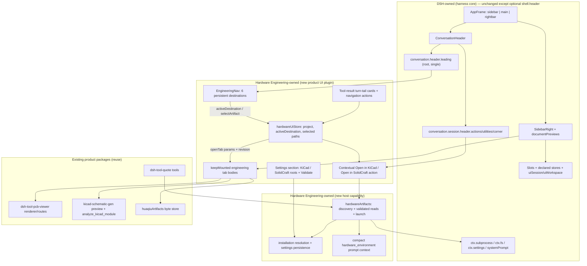

# Hardware Engineering UX — DSH source audit and POC implementation blueprint

**Type:** Source-code audit / implementation feasibility  
**Status:** Complete — audit only, no source files modified by this task  
**Date:** 2026-11-23  
**Specs:** `docs/tasks/dsh-source-audit-hardware-engineering-ux.md`, `docs/tasks/hardware-engineering-artifact-viewer-poc.md`

## Repository baselines

| Repository | Commit | Working tree at audit start |
|---|---|---|
| `deepseek-harness` (Huaqiu DSH fork) | `1a56e234617d2732b0928e1327f46a275e8beb19` | clean |
| `dsh-pcb-eda` | `8566f75ed031a46a4ab7235c4064cd80d5e1b989` | clean |
| `kicad` (supporting source only) | `8a9453e7650eeac4a4359a68f1fb92fd81882a24` | not modified |

All citations below are to these checkouts. Paths beginning `harness/` refer to `/Users/admin/code/deepseek-harness`; paths beginning `product/` refer to `/Users/admin/code/dsh-pcb-eda`.

---

## A. Executive decision

**Can the approved UX be implemented mostly through existing DSH extension points?** Yes, with one qualification. Every part of the UX except a true full-width application header can be built with existing, typed slots, stores, sidebar tabs, document previews, settings forms, and host services. The qualification is important: DSH has **no application-level header row**. The product logo lives in the sidebar and the header-like toolbar lives inside the center conversation column. A persistent six-destination navigation can be mounted in the root-scoped `conversation.header.leading` seat, but that seat is confined to the center column and unmounts while a global main panel replaces the conversation. If the six destinations must span the whole window and remain mounted in every panel state, one small DSH core change is required: add a root `shell.header` slot to `AppFrame`.

**Which changes require DSH core modifications?** Strictly required: none for the POC if the navigation is accepted inside the conversation header. One optional, small core change if a full-width always-mounted bar is non-negotiable. One process-level fix is unavoidable before any 0.7.11 product change can be verified: the harness currently has a **0.7.10/0.7.11 lockstep break** between source, CLI dependencies, workspace pins, the installed bundle and the distribution verifier. That is not a UX extension gap; it is a release-integrity blocker.

**Is the right-side document preview sufficient for the interactive viewer?** Yes, with one configuration. `ctx.sidebarRightTabs.register(...)`, `ctx.sidebarRight.openTab(...)`, `ctx.documentPreviews.register(...)`, and a `keepMounted: true` tab type provide the required surface, lifecycle and navigation mechanism. The current Huaqiu PCB viewer does **not** use this surface: it renders a turn-tail card plus a `position: fixed` floating panel driven by module-level singletons. The right answer is to re-host its existing renderer in a supported tab body, not to rewrite the PCB parser/renderer and not to copy its singleton pattern into new code.

**Minimum viable implementation architecture:** one new Hardware Engineering UI plugin plus one new host capability, both mounted through the existing product bundle. The UI plugin owns a single product store, the six-destination navigation, artifact selectors, viewer tab bodies, contextual actions, and settings presentation. The host capability owns deterministic artifact discovery, validated reads, installation resolution, native process launch, BOM/ERC result delivery, and a compact agent-context contribution. Native files stay authoritative; no project database, IR, daemon, HQ Edge, Electron change, or new agent loop is introduced.

---

## B. Source evidence matrix

Classification: **Reuse** = existing behavior used unchanged; **Plugin extension** = supported API, no DSH core edit; **DSH core change** = source edit in the fork required. Confidence: **Confirmed**, **Partial**, **Unknown**.

### Audit A — top navigation and product identity

| Feature | Current implementation | Source location | Extension point | Gap | Proposed solution | Classification | Confidence |
|---|---|---|---|---|---|---|---|
| Top-level shell | Three-column `AppFrame` with `sidebar`, `main`, `rightbar`, `shell.bottom`, `shell.overlay`, `shell.leading`; no header slot. | `harness/packages/client/ui-layout/src/client/AppFrame.tsx:31-38`, render calls `:273-285`, `:307-335`; `AppFrame.module.css:1-9` | root/sidebar/main/rightbar slots | No full-width header track. | Add `shell.header` to `AppFrameProps`, render it above columns, add an `auto` grid row. | DSH core change (only for full-width bar) | Confirmed |
| Product identity | Brand is in the sidebar logo row (`sidebar.brand.mark`, `sidebar.brand.name`), already overridden by Huaqiu theme. | `harness/packages/client/ui-sidebar/src/client/SidebarRoot.tsx:284-305`, `:330-379`; `product/packages/dsh-ui-theme-huaqiu/src/client/index.ts:58-60` | `sidebar.brand.mark/name` | Not a navigation surface. | Keep brand as-is; render product title/project path inside the new navigation contribution. | Reuse | Confirmed |
| Header-like toolbar | `ConversationHeader` in the center column renders `conversation.header.leading` then `conversation.session.header`. | `harness/packages/client/ui-conversation/src/client/skeleton/ConversationHeader.tsx:12-29`; `ConversationMainPanel.tsx:39` | `conversation.header.leading` (root, single), `conversation.session.header.*` | Center-column width only. | Mount one product-owned navigation occupant in `conversation.header.leading`. | Plugin extension | Confirmed |
| Project path | No project-path display in DSH core; breadcrumbs show session-title ancestry. Workspace path exists in the picker, not the header. | `ConversationSession.tsx:145-204`; `harness/packages/client/ui-layout/src/client/DocumentTitle.tsx:17-28`; `harness/packages/client/ui-workspace/src/client/WorkspacePicker.tsx:119` | none in core | Product must source and render its own path. | Product store derives path from session `cwd` and selected `.kicad_pro`; render it in the navigation contribution. | Plugin extension | Confirmed |
| Six persistent destinations | `conversation.header.leading` is root-scoped, single-seat, and documented as global navigation available without a session. | `harness/packages/client/ui-conversation/src/client/contract/slots.ts:265-270`; generated catalog `harness/packages/cordis-client-runner/src/client/slot-catalog.ts:1024-1055`; no-session test `ui-conversation/tests/skeleton.client.spec.tsx:441-447` | `conversation.header.leading` | Single seat is fine, but component unmounts while a global main panel is active. | One occupant owns all six labels and active state; accept caveat or add `shell.header`. | Plugin extension / DSH core change for full persistence | Confirmed |
| Active state and lifecycle | No product router exists; analogous state is plugin-owned (`activePanelId`, sidebar tab domains). | `SidebarRoot.tsx:72-99`; `harness/packages/client/ui-sidebar-right/src/client/contract/slots.ts:109-121`; `tab-domain.ts:48-63` | plugin store | No shared route state between six destinations. | Product store field `activeDestination`; actions switch destination and artifact. | Plugin extension | Confirmed |
| No open project | Header still renders with no session; sidebar-right `require()` throws until a session surface exists. | `ConversationHeader.tsx:22-27`; `harness/packages/client/ui-sidebar-right/src/client/service.ts:854-864` | `conversation.header.leading` | Viewer tabs cannot open before a session. | Keep all six labels visible with empty states; defer `openTab` until a session is mounted. | Plugin extension | Confirmed |

### Audit B / I — viewer surface and responsive layout

| Feature | Current implementation | Source location | Extension point | Gap | Proposed solution | Classification | Confidence |
|---|---|---|---|---|---|---|---|
| Right-panel arbitrary React bodies | `sidebar.right.pane.tab` is a keyed session slot; tab bodies are custom React components. | `harness/packages/client/ui-sidebar-right/src/client/index.ts:22-25`, `:232-264`; `SidebarRight.tsx:193-246` | `ctx.sidebarRightTabs.register` + keyed slot | None. | Register one engineering tab type. | Plugin extension | Confirmed |
| `ctx.sidebarRight` API | `openTab(kind, {params})` / `openResource(address, …)` with `paneId`, `replaceTab`, `revealIfOpened`, `destination`. | `ui-sidebar-right/src/client/index.ts:89`, `:107-118`, `:182-183`, `:200-229`; `service.ts:155-201`, `:215-298` | `ctx.sidebarRight`, `ctx.sidebarRightTabs` | Requires an on-screen session. | Drive viewer on destination change; pass artifact path/params. | Plugin extension | Confirmed |
| Document preview registry | `ctx.documentPreviews.register(...)` per extension; `loading: 'renderer'` lets renderer own content and revision. | `ui-sidebar-documentpreview/src/client/index.ts:55-60`, `:91-119`; `document/registry.ts:5-33`, `:41-54`, `:71-133`; `document/contract.ts:17-46` | `ctx.documentPreviews` | None for file-based artifacts. | Register `.kicad_sch`, `.kicad_pcb`, `.step`, `.stp`, `.glb`, BOM output renderers. | Plugin extension | Confirmed |
| Long-lived viewer state | `keepMounted?: boolean` retains a visited body through hiding, session changes and docking; document-preview stores already outlive bodies. | `ui-sidebar-right/src/client/tab-registry.ts:103-110`; `SidebarRight.tsx:203-225`, `:353-372`; `session-view.ts:37-40`, `:54-75`; `TextPreview.tsx:128-136`, `:391-397` | `keepMounted` on tab type | Default false; current PCB viewer does not use it. | Set `keepMounted: true` for engineering tabs; keep render state in a declared store. | Plugin extension | Confirmed (dockkit internals Partial) |
| Selection updates without remount | Tab domain has `address`, `params`, `revision`; `revealIfOpened` dedups tabs. | `ui-sidebar-right/src/client/contract/slots.ts:109-121`; `tab-domain.ts:130-145`; `service.ts:486-531`; `TextPreview.tsx:155-183` | `navigation.params/revision` | Product must encode artifact identity in params. | Pass canonical path + kind; viewer reacts to `revision`. | Plugin extension | Confirmed |
| Resize / collapse / expand | Frame drag handle writes `layout.setRightbar`; panel supports push/fullscreen and docked bodies translate rather than unmount. | `AppFrame.tsx:62-126`, `:257-260`, `:336-340`; `SidebarRight.tsx:272-305`, `:312-376`; `SidebarRight.module.css:31-100` | `ctx.layout`, `ctx.sidebarRight` | None. | Reuse unchanged. | Reuse | Confirmed |
| Center chat visibility | Push mode preserves a center track; fullscreen covers the frame; auto-fullscreen below 768px. | `AppFrame.tsx:184-200`, `:269`, `:295-297`; `SidebarRight.tsx:398-405`; `columns.ts:10-11`, `:55-64` | `autoFullscreen`, mode | Fullscreen intentionally covers chat. | Use push mode for the POC; document fullscreen behavior. | Reuse | Confirmed |
| Nested scrollbars | Preview root/body use flex `min-width:0`; `.body` is the single scroller; renderers can supply `scrollportRef`. | `TextPreview.module.css:4-32`, `:71-102`; `document/contract.ts:44-45`; `TextPreview.tsx:101-126` | `DocumentBodyOwner.scrollportRef` | None. | Bind viewer canvas container as scrollport. | Reuse / Plugin extension | Confirmed |
| Width constraints | `CENTER_MIN=400`, `SIDEBAR_MIN=264`, `SIDEBAR_MAX=420`, `RIGHTBAR_MIN=300`, `RIGHTBAR_MAX_RATIO=0.7`; sidebar auto-collapse 1024, drawer 768. | `harness/packages/client/ui-layout/src/client/columns.ts:10-31`; `AppFrame.tsx:170-179`, `:286`; `AppFrame.module.css:288-369` | `ctx.layout` | Six labels + project path tight at 400px center. | Wrap labels or use explicit More affordance; never silently hide destinations. | Reuse + Plugin extension | Confirmed |
| Header overflow pattern | Core uses ellipsis for crumbs/tab labels, wrapping view tabs and a More menu; header actions are `flex:none`. | `ConversationRoot.module.css:23-36`, `:65-107`, `:120-157`, `:171-222`, `:225-252`, `:299-323`; `ConversationSession.tsx:140-144` | header action slots | No reserved lane for product nav. | Product nav wraps; contextual action stays in `conversation.session.header.corner`. | Reuse + Plugin extension | Confirmed |
| Native titlebar | Electron uses hidden titlebar / Windows overlay; no native place for product navigation. | `harness/apps/desktop/src/main.ts:276-283` | none | — | Keep everything in renderer slots. | Reuse | Confirmed |

### Audit C / J — product state, context and packaging

| Feature | Current implementation | Source location | Extension point | Gap | Proposed solution | Classification | Confidence |
|---|---|---|---|---|---|---|---|
| Bundle activation | `@huaqiu/hardware-engineering` is a bundle, not a row: DSH reads `dsh.bundle.patch` and merges nine plugin rows into the desktop profile. | `product/packages/hardware-engineering/src/index.ts:1-27`, `:58-103`; `cordis.patch.yml:43-86`; `harness/apps/cli/src/profile-boot.ts:80-85` | `dsh.bundle.patch`, `dsh.profile.bundles` | No product UI row. | Add one UI plugin dependency + one patch row + ledger/test entry. | Plugin extension | Confirmed |
| Current 0.7.11 bundle | Version `0.7.11`, 9 exact dependencies, 9 mounted rows, `listedByDefault: false`. `@huaqiu/dsh-tool-pcb-viewer` and `dsh-eda-selection` are **not** in the source bundle. | `product/packages/hardware-engineering/package.json`; `src/index.ts:58-103`; `cordis.patch.yml:49-85` | bundle manifest | PCB viewer not shipped by the product bundle. | Add pcb-viewer dependency if its renderer is to be re-hosted by the product viewer. | Plugin extension | Confirmed |
| Shared product store | A single declared `StoreHandle` may be attached to multiple slot registrations at the same scope; module-level exports are explicitly forbidden. | `harness/packages/client/store/src/contract.ts:86-117`; `ui-slots/src/index.ts:861-862`, `:1288-1298`; worked example `ui-sidebar-documentpreview/src/client/store.ts:115-122` | declarative `defineStore` + `store:` | Handle must travel through a service from apply world. | Provide one product store handle from the UI plugin/service; attach to nav, viewer and action registrations. | Reuse + Plugin extension | Confirmed |
| State survival | Root store = one instance for app lifetime; session store = per-session instances with `persist.<sessionId>`. | `ui-renderer/src/client/registry.ts:354-372`, `:604-627`; `store/src/index.ts:221-227` | `StoreSpec.persist`, `create(scopeKey)` | Choose root vs session deliberately. | Root store for navigation continuity; session store + persist for selected project/artifact. | Reuse | Confirmed |
| Session / workspace context | `SessionSummary.cwd`, `useSessions`, `useWorkspaces`, `ctx.workingDirectory` exist. No first-class “active project”. | `harness/packages/api/session-controller/src/client/sessions/service.ts:26-58`; `ui-workspace/src/client/index.ts:72-84`; `session-controller/src/index.ts:373-394` | `useSessions`, `ctx.workingDirectory` | DSH cannot distinguish selected project from previewed document. | Product store holds canonical `.kicad_pro` path; preview tabs remain independent. | Reuse + Plugin extension | Confirmed |
| Artifact pointers | `huaqiuArtifacts` is a flat byte-artifact store, not a project DB. | `product/packages/dsh-artifacts/src/service.ts:1-19`, `:58-86` | artifact ids + content route | No project/sheet/board resolver. | Product store stores canonical absolute paths; native files remain authoritative. | Plugin extension | Confirmed |
| Existing viewer anti-pattern | PCB viewer uses module-level `previewIndex`, `panelStore`, fixed overlay. | `product/packages/dsh-tool-pcb-viewer/src/client/panel.tsx:205-206`, `:231-236`, `:485-506` | `conversation.chat.turnTail`, `conversation.session.header.actions` | Singleton not lifecycle-safe; fixed panel duplicates right panel. | Reuse renderer; re-host with declared store and supported tab slots. | Plugin extension | Confirmed |
| Settings persistence | `ctx.configForms` is host-document backed; settings sections are root-scope list slots; host settings persist into the active Cordis profile patch. | `ui-settings/src/client/config-form.ts:223-328`; `ui-settings-general/src/client/index.ts:242-243`, `:266-267`; `settings/settings/src/index.ts:343-361` | `ctx.configForms`, `settings.section` | No CAD path namespaces. | Add `hardware.kicad.installation` and `hardware.solidcraft.installation`. | Plugin extension | Confirmed |
| Offline startup | Bundle resolved from installation-anchor dependency graph; profile-local install not required. | `harness/apps/cli/src/profile-boot.ts:77-85`; `product/packages/hardware-engineering/cordis.patch.yml:9-13` | installation anchor | None. | Add new plugin as bundle dependency; never profile-local install. | Reuse | Confirmed |
| Version lockstep | Product repo all `0.7.11`; CLI declares bundle `0.7.11`; harness workspace pinned exceptions, verifier `PRODUCT_VERSION`, and installed bundle are `0.7.10`. | `product/scripts/check-release-version.mjs:31-68`; `harness/apps/cli/package.json:91-92`; `harness/pnpm-workspace.yaml:21-27`, `:114-129`; `harness/scripts/verify-huaqiu-desktop-distribution.ts:27`, `:120-170` | release gates | **Blocker:** three-way drift; gate fails as checked out. | Reconcile pins, lockfile, installed artifact and verifier to one published version before adding new plugin rows. | Process fix + DSH core verifier change | Confirmed |

### Audit D — viewers, BOM, DFM and 3D

Foundation packages are installed artifacts, not local source: `@huaqiu/kicad-sexpr-parser@0.1.1` and `@huaqiu/ecad-renderer@0.2.4` live under `product/node_modules/.pnpm/`. The renderer exports `renderSymbol`, `renderFootprint`, `renderSchematic`, `renderPcb`, `loadProjectZip`, `renderProjectFromZip`; `RenderResult.viewer` is typed `unknown` (`.../@huaqiu+ecad-renderer@0.2.4/node_modules/@huaqiu/ecad-renderer/dist/index.d.ts:1-32`). Parser PODs include symbols, instances, sheets, sheet pins, wires, buses, junctions, labels, graphics and DNP/BOM flags (`.../@huaqiu+kicad-sexpr-parser@0.1.1/.../dist/proto/schematic.d.ts:1-373`).

| Feature | Current implementation | Source location | Data input / interaction | Gap | Proposed solution | Classification | Confidence |
|---|---|---|---|---|---|---|---|
| Schematic parse | Parser POD covers required primitives and instance flags; `parse()` handles one file, no hierarchy walk. | parser `schematic_parser.d.ts:24-30`, `proto/schematic.d.ts:22-46`, `:118-160`, `:169-300` | raw `.kicad_sch`; pure parse | No sheet traversal, no typed selection API. | Reuse parser; caller resolves hierarchy from existing analysis code. | Reuse | Confirmed |
| Schematic preview | `kicad-cli sch export svg --exclude-drawing-sheet` → `sharp` PNG; revision cache; page crops; HTTP route and turn-tail card. | `product/packages/dsh-tool-kicad-schematic-gen/src/schematic/preview.ts:241-264`, `:266-346`; `tools.ts:307`, `:412-414`; `overview.ts:11`, `:69-87` | root + child sheets; static PNG | No browser zoom/pan; agent-invoked, not persistent destination. | Wrap existing PNG route with CSS transform zoom/pan + sheet selector using `pages[].pageSchematicPath`. | Plugin extension | Confirmed |
| PCB parser/renderer | Existing viewer has its own linear parser and an adapter to the `@huaqiu` parser; flat `BoardModel`; canvas 2D pan/zoom plus Three.js 3D orbit/explode. | `product/packages/dsh-tool-pcb-viewer/src/parse.ts:1-24`; `adapter.ts:17`, `:237`; `model.ts:81-91`; `viewer.ts:168-196`, `:198-556`; `scene/view2d.ts:14-225` | `.kicad_pcb` text; 2D/3D interaction | No layer visibility toggle; no typed pick/highlight API. | Reuse unchanged; add small `setLayerVisible()` / `highlight()` to existing `ViewerApi` only if required. | Reuse / Plugin extension | Confirmed |
| PCB host delivery | `pcb_preview` tool, 32-entry UUID registry, read-only `/pcb-viewer/api/file?key=`, `/view`, `/standalone.js`, localhost guard, 120 MB cap. | `product/packages/dsh-tool-pcb-viewer/src/index.ts:43`, `:59-70`, `:100-106`, `:152-217`, `:219-301` | absolute path or session cwd; read-only HTTP | Not session-isolated; no board picker. | Reuse route; pass exact selected board path into the tool. | Reuse | Confirmed |
| PCB current integration | Turn-tail chain slot + observer in header actions; large viewer is fixed overlay with module singletons. No `sidebarRightTabs`, `documentPreviews`, or `sidebar.right.pane.tab` registration. | `panel.tsx:57`, `:155-206`, `:231-236`, `:396-463`, `:485-506` | tool-result JSON + session snapshots | Not in the supported right panel; stale `chain`/`select` pattern vs HEAD `list` slot. | Re-host renderer in `keepMounted` tab; register turn-tail card with current `list` + `id` contract. | Plugin extension | Confirmed |
| ERC / DFM | `verifySchematic`/`verifyNetlist` use `kicad-cli sch erc --format json --severity-all`; schema has violations with sheet/severity/type/description. No score. Functions exported but never registered as a tool. | `product/packages/dsh-tool-kicad-schematic-gen/src/schematic/verify.ts:31-49`, `:86-110`, `:184-226`; `index.ts` apply block | saved schematic + netlist | No DRC implementation; no coordinates/UUID for precise highlight; no score. | Register thin read-only ERC tool; show counts, not a fabricated score; navigate by sheet path. | Plugin extension | Confirmed |
| DRC | `@huaqiu/dsh-kicad-drc@0.6.30` appears only in the release manifest; no source in checkout. | `product/release-manifest/plugins-release-manifest.json:149-161`; `product/M1-hardware-engineering-poc-report.md:229` | unknown | Behavior/schema/score unverifiable. | Show explicit “not analyzed” until integrated. | Unknown | Unknown |
| BOM | `analyze_kicad_module` with `view:'bom'` merges netlist properties and `sch export bom`; grouped view; group key includes sorted fields, so different MPNs are not merged. | `product/.../schematic/module-analysis.ts:19-38`, `:43-63`, `:65-115`, `:218-226`, `:256-301`; `analysis-tool.ts:24-68`, `:70-130` | root + child sheets copied to temp dir with rewritten `Sheetfile` | No pricing/inventory; no explicit manufacturer/MPN columns; BOM rows lack sheet path/UUID. | Reuse tool result; add presentation mapping and extend output with `fields.MPN`, `fields.Manufacturer`, `sheetPath`. **Second parser not justified.** | Reuse + small plugin extension | Confirmed |
| PCB 3D | Same Three.js viewer renders procedural board stackup from parsed PCB; no `pcb export glb` in source; no `GLTFLoader`. | `product/packages/dsh-tool-pcb-viewer/src/viewer.ts:248-379`, `:455-511`; `scene/buildBoard.ts` | `.kicad_pcb` text | Not GLB-derived; no mechanical model path. | Reuse existing PCB 3D for POC; optional later host GLB export. | Reuse | Confirmed |
| Mechanical 3D | No STEP/STP/GLB viewer in either repo; `.step/.wrl` appear only in generated project ZIP snapshots. | `product/.../schematic/overview.ts:48`; POC spec `:205`, `:412` | none | Whole capability absent; SolidCraft invocation unverified. | Add host file route + Three.js `GLTFLoader` for `.glb`; treat STEP/STP conversion as blocked until a supported converter is verified. | New capability / Unknown for STEP | Unknown (absence Confirmed) |

### Audit E / H — native launch, settings, agent context

| Feature | Current implementation | Source location | Extension point | Gap | Proposed solution | Classification | Confidence |
|---|---|---|---|---|---|---|---|
| Open-in-app catalog | Compile-time fixed whitelist of editors/terminals/file managers; no KiCad or SolidCraft; no registration API. README says catalog is fixed and custom handlers deferred. | `harness/packages/host/open-in-app/src/catalog.ts:10-103`, `:181-393`; `resolver.ts:647-662`; `index.ts:219`, `:274`; `README.md:54`, `:112` | `OPEN_IN_APP_CATALOG` (core edit) | Cannot add configurable CAD handlers. | Leave catalog untouched; add dedicated `hardwareArtifacts` host capability. | Plugin extension | Confirmed |
| Artifact path | Route requires `{app, path}` and `stat(path).isDirectory()`; artifact files are rejected. `session.openWorkspacePath` accepts files but uses OS association. | `host/open-in-app/src/index.ts:241-310` (esp. `:280-293`); `shared.ts:33-37`; `api/session-controller/src/index.ts:373-394`, `:418-429`; `util/native-command/src/file-applications.ts:171-184` | host request | Cannot target a configured executable. | New host request `{application, artifactPath, kind}` with explicit validation. | Plugin extension | Confirmed |
| Shell-free launch pattern | `launchDetachedApp` uses `spawn(command, args, {detached:true, stdio:'ignore', windowsHide, env})`; failures reported as `502 launch-failed`. | `host/open-in-app/src/resolver.ts:44-56`, `:74-96`, `:679-760`; `index.ts:295-308` | existing pattern | None. | Reuse the pattern in the host capability; never build a shell string. | Reuse | Confirmed |
| Dynamic action | Client stores one choice in localStorage and filters by hardcoded `APP_LABEL_KEY`; contributions are fixed slot registrations. | `client/ui-open-in-app/src/client/controller.ts:28-44`; `applications.ts:5-40`; `client/index.ts:114-144` | `sidebar.right.tab.document.actions` | No per-destination binding. | Register one product action keyed on active destination. | Plugin extension | Confirmed |
| Subprocess API | `resolveExecutable(command, env?, signal?)` and `spawn(spec)` with explicit `argv`, `cwd`, `env` over a scrubbed base; `argv` never shell-interpreted. Managed children die on service disposal. | `harness/packages/subprocess/subprocess/src/index.ts:117-163`, `:66-80`; `types.ts:77-107`, `:169-196` | `ctx.subprocess` | GUI launch must outlive service disposal. | Use `ctx.subprocess` for probes; use detached spawn pattern for GUI launch. | Reuse | Confirmed |
| Scoped agent env | No feature service mutates `process.env` for executables; global writes are boot config and proxy only. | `subprocess/.../index.ts:47`, `:66-80`; `boot/app-boot/src/index.ts:249`; `util/http-proxy/src/install.ts:139` | spawn spec `env` | No `HUAQIU_*` convention yet. | Pass `HUAQIU_KICAD_CLI`, `HUAQIU_KICAD_PCBNEW`, `HUAQIU_KICAD_EESCHEMA`, `HUAQIU_SOLIDCRAFT` via per-spawn `env`. | Reuse + Plugin extension | Confirmed |
| Agent context | `ctx.systemPrompt.context()` / `section()` / `refreshContext()` exist; exemplars in working-directory and `dsh-eda-selection`. | `core/system-prompt/src/index.ts:486-530`, `:590-600`; `session/working-directory/src/index.ts:90-110`, `:172-174`; `product/packages/dsh-eda-selection/src/prompt.ts:68-128` | `ctx.systemPrompt.context()` | No validated hardware environment block. | Register compact `interpolate:false` context from cached validated settings. | Plugin extension | Confirmed |
| Workspace file access | `ctx.fs`; `ctx.remote.workspaceFiles` read/readBytes/stat/list/changes; reads may cross workspace when authorized, listings confined. | `api/workspace-files/src/index.ts:1-19`, `:182-455` (confine `:402-409`); `fs/fs/src/index.ts:52-55`, `:103+` | `ctx.fs`, `ctx.remote.workspaceFiles` | None. | Use directly for artifact reads. | Reuse | Confirmed |
| Settings forms | `ctx.configForms.get/whileServed/set/unset`; `settings.section` root list slot; host settings write user-scoped profile patch. | `ui-settings/src/client/config-form.ts:223-328`; `config-form-types.ts:8-74`; `contract/slots.ts:57-98`; `settings/settings/src/index.ts:343-361`; example `product/packages/dsh-huaqiu-about/src/client/index.ts:52-64` | `settings.section`, `ctx.configForms` | No CAD path section or validation action. | One settings section with two path rows, Validate action backed by host remote. | Plugin extension | Confirmed |
| Native picker | Native **directory** picker only: macOS `canChooseFiles=false`, Win32 `FOS_PICKFOLDERS`. | `host/directory-picker-native/src/index.ts:22-37`; `native-picker.ts:35-66`, `:93-143`; `win32-dialog-logic.ts:12-13`, `:131`; `client/ui-directory-picker-native/src/client/index.ts:14-42` | `ctx.directoryPicker`, `directoryPicker/pick` | No file picker for executables. | Pick installation root; resolve known executable names beneath it. | Reuse | Confirmed |
| Local KiCad | Huaqiu fork 10.0.7 at `/Applications/KiCad/KiCad.app`; CLI, `kicad`, `eeschema`, `pcbnew` inside bundle; none on PATH. | command evidence: `/Applications/KiCad/KiCad.app/Contents/MacOS/kicad-cli version` → `10.0.7`; `Contents/Applications/{eeschema,pcbnew}.app/Contents/MacOS/*` | configurable root | PATH resolution fails without explicit path. | Default root + validation; resolve editors beside `kicad-cli`. | Existing environment | Confirmed |
| Local SolidCraft | No installation found by `mdfind` or common paths; no version/CLI args anywhere in source. | command evidence: `mdfind -name SolidCraft` empty; POC spec `:205`, `:412`, `:685`, `:701-706` only | none | **Blocker** for demo steps 12–13. | Do not infer FreeCAD args; block launch action until installation supplied. | Unknown | Unknown |
| Windows KiCad layout | `.exe` names and `C:\Program Files\KiCad\10.0\bin\` in kicad source; no Windows host available. | `kicad/common/executable_names.cpp:29-40`; `kicad/qa/tests/common/test_jobs_runner.cpp:178-184`; `kicad/api/proto/common/commands/base_commands.proto:40-47` | Backplane reference `open.rs` `program()`/`launch()` | Cannot runtime-verify here. | Resolve `tool`/`tool.exe` beside configured CLI; verify on Windows later. | Partial | Partial |

### Audit F / G — order workflows and agent interoperability

| Feature | Current implementation | Source location | Extension point | Gap | Proposed solution | Classification | Confidence |
|---|---|---|---|---|---|---|---|
| Four quote/order tools | `quote_pcb`, `quote_smt`, `place_pcb_order`, `place_smt_order`; flat manufacturing params, optional region enum. | `product/packages/dsh-tool-quote/src/tools.ts:54-353` (`99`, `117-190`, `192-202`, `205`, `220-289`, `292`, `305-321`, `324`, `334-350`) | `ctx.tools.register` | None for agent use. | Reuse as-is for the agent path. | Reuse | Confirmed |
| Quote vs submission | Quote endpoints never place; tests assert `place:false`. Place tools open an external editor order dialog, where the user completes the order. | `tools.ts:192-202`, `:316-350`; `test/quote-tools.test.ts:64-90`, `:148-162`, `:177-191`, `:237-252`; `client.ts:183-190` | host client | No DSH-side explicit confirm gate. | Add a thin UI-facing wrapper; call place only after explicit user confirmation. | Plugin extension | Confirmed |
| Board/BOM inputs | No path/ID/BOM parameter in any tool. Descriptions rely on the “currently open board” in the EDA host/hq-edge; place payload is only `{region}`. | `tools.ts:106-110`, `:211-213`, `:294-302`, `:305-314`, `:334-343` | none today | Selected product board/BOM cannot be passed. | Thin host wrapper accepts validated `boardPath`/`bomPath` or artifact URI; resolve from session cwd. | Plugin extension | Confirmed (gap); upstream contract Unknown |
| Quote UI | None. Package exports only `lib/index.mjs`, patch and package.json; node-only row `inject: ['tools']`. | `product/packages/dsh-tool-quote/package.json:5-13`; `tsdown.config.ts:3-8`; `src/index.ts:47`, `:53`, `:123`; `cordis.patch.yml:13-16` | none | All order UI missing. | New thin client contribution + host route/remote. | Plugin extension | Confirmed |
| Backend availability | No quote base URL in target runtime; tools fail with `FAILED_PRECONDITION` (412). | `client.ts:90-101`; `src/index.ts:114-119`; `product/docs/m1/capability-matrix.md:21` | late-bound config | Order workflows non-functional until backend configured. | Surface explicit unavailable state; do not fake quotes. | External blocker | Confirmed |
| Tool result → card | Generic `presentCall`/`presentResult` have no `actions` field; keyed `tool.call.toolview` slot can replace cards. | `harness/packages/core/tools/src/presentation.ts:46-75`, `:140-155`; `contracts.ts:93`, `:101`; `product/packages/dsh-tool-symbol-footprint/src/client/index.ts:25-29`, `:193-198` | `tool.call.toolview` | Navigation actions cannot live in tool presentation metadata. | Product card in keyed slot with actions. | Plugin extension | Confirmed |
| Turn-tail navigation | `conversation.chat.turnTail` is a `list`, session-scoped slot with required `id`; PCB viewer uses stale `chain`/`select`/no-id pattern. | `harness/packages/client/ui-chat/src/client/contract/slots.ts:59-64`, `:499-504`; `TurnTailNodeView.tsx:28-81`; `product/.../pcb-viewer/src/client/panel.tsx:485-506` | `conversation.chat.turnTail` | Existing pattern must be re-expressed. | Register fresh `id`; read data via declared store/hooks. | Plugin extension | Confirmed |
| Navigate without new turn | `ctx.sidebarRight.openResource(...)`, tab registry and keyed pane body already used by deliverables. | `harness/packages/client/ui-deliverables/src/client/index.ts:46`, `:64-84`, `:89-103`; `ui-sidebar-right/src/client/index.ts:182-183`, `:200-264` | `ctx.sidebarRight`, `ctx.sidebarRightTabs` | None for basic navigation. | Use directly for “View PCB / Open BOM / Start order” actions. | Reuse | Confirmed |
| Artifact identity boundary | `art_<hex>` ids + same-origin content route; `getDownloadUri()` for cross-process references; PCB viewer uses opaque `pcb-<uuid>` key + `viewUrl`. | `product/packages/dsh-artifacts/src/service.ts:98-99`, `:249-258`; `routes.ts:18`, `:46-95`; `pcb-viewer/src/index.ts:290-299` | artifact service + webServer | Cross-process references must use URI, not store-local id. | Pass opaque id/URI; resolve inside viewer. | Reuse | Confirmed |
| Refresh active viewer | Document-preview store has refresh state; PCB viewer reloads on preview key change. | `ui-sidebar-documentpreview` store and `TextPreview.tsx`; `product/.../panel.tsx:332-356` | declared store + inject callbacks | No generic cross-plugin refresh call. | Product store action `refreshActiveArtifact`; call from result/card actions. | Plugin extension | Confirmed / Partial |

---

## C. UI ownership diagram

The agent conversation remains DSH-owned and independent: tool results may call product store actions to open a destination, but the conversation component itself is not replaced or forked.

---

## D. Proposed navigation and interaction flow

1. **First launch, no project.** All six destinations render in `conversation.header.leading`. The active destination shows an empty state: **Open Project**, **New Project**, **Ask AI Hardware Engineer**. No `sidebarRight.openTab` call occurs because no session surface is mounted. Settings can already be configured through `settings.section`.
2. **Opening an existing project.** The user opens a workspace/session. The host capability reads `SessionSummary.cwd`, applies optional `.hardware-engineering.json`, and otherwise requires an unambiguous `.kicad_pro`. The product store records the canonical absolute project path; a preview tab is not treated as a project selection.
3. **Switching destinations.** `activeDestination` is a store action; the store calls `ctx.sidebarRight.openTab` with the current artifact path in `params`. `keepMounted: true` preserves the renderer; a `revision` bump updates selection instead of remounting.
4. **Missing artifact.** The destination remains visible and labeled. The viewer shows the source filename/path that was searched, why nothing was found, and the next action (select a board/sheet/model or generate via agent). No fabricated DFM score.
5. **Agent result → viewer.** A product-owned `tool.call.toolview` card or `conversation.chat.turnTail` list item exposes “View schematic / View PCB / Review DFM / Open BOM / Inspect 3D / Start PCB fabrication / Start PCBA assembly”. The action calls the product store; `ctx.sidebarRight.openResource/openTab` navigates without starting a new agent turn.
6. **Native application handoff.** The top-right action is derived from `activeDestination`: KiCad for schematic/PCB/PCB 3D/DFM/BOM, SolidCraft for mechanical 3D, none for Order. The host validates the exact artifact path and configured executable, then launches with explicit `argv`, cwd = artifact parent, no shell. The displayed artifact is the one opened — never a rediscovered default.
7. **PCB fabrication.** Order Placing → PCB Fabrication: select the current board, review flat fabrication inputs and region, request quote via the existing quote payload path, review pricing/options, then explicitly confirm. Only the confirm action may call `place_pcb_order`.
8. **PCBA assembly.** Order Placing → PCBA Assembly: select board + its BOM from the same project/schematic, review sourcing inputs, quote, review, then explicitly confirm `place_smt_order`. No implicit submission on page open or quote.

---

## E. Minimal change list

### Existing DSH APIs reused unchanged

- `conversation.header.leading` (root, single) for one product navigation contribution.
- `conversation.session.header.actions/utilities/corner` for contextual native action.
- `ctx.sidebarRightTabs.register`, `ctx.sidebarRight.openTab/openResource`, `sidebar.right.pane.tab`, `keepMounted`, `navigation.params/revision`.
- `ctx.documentPreviews.register` for file extensions where a resource-based preview is preferable.
- Declarative stores (`defineStore`, shared handle at one scope, `persist`) and `ctx.slots` typed declarations.
- `ctx.configForms`, `settings.section`, profile-patch-backed host settings.
- `ctx.subprocess.resolveExecutable/spawn(spec)` for probes; detached spawn pattern for GUI apps.
- `ctx.fs`, `ctx.remote.workspaceFiles`, artifact content routes, `getDownloadUri()`.
- `ctx.systemPrompt.context()`, `ctx.systemPrompt.refreshContext()`.
- `conversation.chat.turnTail` (list + `id`), `tool.call.toolview`, `ctx.remote.session`.
- Frame resize/collapse/fullscreen, width constants, ellipsis and wrap/More patterns.
- Native **directory** picker for installation roots.

### Hardware Engineering plugin changes (new package or small set inside the bundle)

- New `@huaqiu/dsh-hardware-ui` client plugin: navigation, store, selectors, tab bodies, toolbar actions, settings section, result cards.
- New `@huaqiu/hardware-artifacts` host plugin: `hardwareArtifacts` service, host routes/remote, installation resolution, native launch, prompt context.
- Add both as exact dependencies of `@huaqiu/hardware-engineering`; add two patch rows; update `src/index.ts` ledger and `test/bundle.test.ts`.
- Add `@huaqiu/dsh-tool-pcb-viewer` as a dependency of the product bundle so the reused renderer actually ships; keep its node row if its tool behavior is still needed.
- Extend BOM analysis output with explicit MPN/manufacturer fields and `sheetPath`; do not add a second BOM parser.
- Register a thin read-only ERC tool over existing `verifySchematic`; show counts, not a score.
- Add a thin order wrapper that separates quote from explicit confirmation and accepts validated board/BOM paths or artifact URIs.

### DSH fork core changes

- **Optional but UX-significant:** add a root `shell.header` slot in `harness/packages/client/ui-layout/src/client/AppFrame.tsx`, its CSS, and the corresponding slot type declaration. Choose this only if the six destinations must be full-width and remain mounted on global panels; otherwise use `conversation.header.leading` and accept the center-column caveat.
- **Required release fix:** reconcile `PRODUCT_VERSION` in `harness/scripts/verify-huaqiu-desktop-distribution.ts`, `pnpm-workspace.yaml` pinned exceptions/lockfile, `apps/cli/package.json`, and installed artifacts to one published version. This is a source change in the fork, justified by the gates themselves.
- No agent-loop, Electron lifecycle, right-sidebar architecture, or open-in-app catalog change is required.

### New UI components

- `EngineeringNav` — six labels, project path, active state, responsive wrap/More.
- `HardwareViewerTab` — `keepMounted` body with artifact header/path and refresh.
- `SchematicPreview`, `PcbPreviewHost`, `BomTable`, `DfmResultView`, `Model3DView`, `OrderEntryView`.
- `ArtifactSelectors` — project/board/sheet/model selectors using canonical absolute paths.
- `HardwareSettingsSection` — two installation roots with Validate/Refresh.
- `ContextualOpenAction` — destination → application mapping with disabled/unconfigured states.
- `HardwareResultCard` — tool-result navigation actions.

### New host-side services

- Only `hardwareArtifacts` is genuinely necessary. It owns discovery, validation, launch and context. Reuse `huaqiuArtifacts` for bytes; do not create a second artifact store or project database.

---

## F. Implementation phases

Adjusted from the audit spec only where source evidence requires it.

- **P0 — Navigation, settings and discovery feasibility.** Reconcile version lockstep. Prove six-destination navigation in `conversation.header.leading` (or add `shell.header` if full-width is mandatory). Add settings sections and host installation validation. Implement deterministic project/board/sheet/mechanical discovery with explicit selection. Expose compact agent context and scoped env names.
- **P1 — Artifact workspace.** Re-host existing PCB viewer in a `keepMounted` right-panel tab. Wrap existing schematic preview PNG route with zoom/pan and sheet selection. Surface `analyze_kicad_module` BOM as a table. Register ERC counts as DFM with explicit “not analyzed” for DRC. Add `.glb` model viewer only after a real model file is available; keep STEP/STP explicitly gated.
- **P2 — Native application actions.** Implement host launch with validated installation, shell-free explicit argv, artifact parent cwd, and failure reporting. Wire contextual actions for all destinations. Verify exact artifact handoff on the local KiCad fork. SolidCraft remains blocked until installed.
- **P3 — Order placing.** Add thin UI-facing quote/confirm wrapper with board/BOM selection from the product store. Keep quote and place strictly separated. Surface unavailable backend state honestly.
- **P4 — Agent interoperability and polish.** Add result cards/navigation actions using existing slots and stores; add refresh after agent operations; finish empty states, responsive wrap/More, and lifecycle tests.

---

## G. Package-level change plan

| Package | Change | Extension point / evidence |
|---|---|---|
| `@huaqiu/hardware-engineering` | Add two plugin dependencies (+ pcb-viewer), two patch rows, ledger/test entries. | `product/packages/hardware-engineering/cordis.patch.yml:43-86`; `src/index.ts:58-103` |
| `@huaqiu/dsh-hardware-ui` (new) | Nav, store, viewer tabs, selectors, settings UI, result cards, contextual actions. | `conversation.header.leading`, `sidebarRightTabs`, `settings.section`, `conversation.chat.turnTail`, `tool.call.toolview` |
| `@huaqiu/hardware-artifacts` (new) | Host service, validated reads, launch, installation resolution, prompt context, order wrapper routes. | `ctx.fs`, `ctx.subprocess`, `ctx.settings`, `ctx.systemPrompt`, `ctx.webServer` |
| `@huaqiu/dsh-tool-pcb-viewer` | Reuse renderer/routes; add right-panel host wrapper; avoid singleton pattern in new code. | `src/viewer.ts`, `src/index.ts:152-301`, `src/client/panel.tsx` |
| `@huaqiu/dsh-tool-kicad-schematic-gen` | Reuse preview/analysis; register ERC tool; enrich BOM fields. | `src/schematic/preview.ts`, `analysis-tool.ts`, `module-analysis.ts`, `verify.ts` |
| `@huaqiu/dsh-tool-quote` | No business-logic change; add UI-facing wrapper elsewhere, preserving quote/place boundary. | `src/tools.ts:54-353` |
| `@huaqiu/dsh-artifacts` | Reuse byte store/content route; no second store. | `src/service.ts`, `src/routes.ts` |
| `harness/packages/client/ui-layout` | Only if full-width header is required: add root `shell.header`. | `AppFrame.tsx:31-38`, `AppFrame.module.css:1-9` |
| `harness/scripts/verify-huaqiu-desktop-distribution.ts`, `pnpm-workspace.yaml` | Fix version drift; no new runtime. | `PRODUCT_VERSION:27`; pinned exceptions `:114-129` |

---

## H. POC test matrix

Status uses executed evidence where available; **Not runnable here** means the audit found no local capability to execute the check.

| # | Acceptance criterion | How to test | Current status / evidence |
|---|---|---|---|
| 1 | One-project workspace resolves without manual configuration | Fixture with one `.kicad_pro`; assert product store path and discovery result | Planned P0; design source-proven |
| 2 | Multiple projects require explicit selection | Two `.kicad_pro` fixture; assert no default pick and selector appears | Planned P0 |
| 3 | Multiple PCB files selectable | Manifest with `boards[]`; assert board picker and opened path | Planned P0/P1 |
| 4 | Hierarchical sheets discoverable | Use `pages[].pageSchematicPath` from `dsh-tool-kicad-schematic-gen` | Supported by existing preview data (`preview.ts:297-305`) |
| 5 | Independent schematics not conflated | Two unrelated roots; assert explicit selection | Planned P0 |
| 6 | Artifact identity uses full path | Assert `id = kind + canonical absolute path` in store/tab params | Planned P0 |
| 7 | BOM/PCB 3D retain source identity | Assert `sourcePath` equals selected schematic/board | Planned P1 |
| 8 | Schematic opens in workspace | Existing PNG route + sheet selector in right panel | Route confirmed; UI not built |
| 9 | PCB opens in workspace | Re-host existing viewer in `keepMounted` tab | Renderer confirmed; tab host not built |
| 10 | BOM derived from selected schematic | Call `analyze_kicad_module` with stored schematic path | Reuse confirmed (`module-analysis.ts`) |
| 11 | BOM hierarchy + DNP/exclusion | Netlist properties + `dnp`, `excludeFromBom`, `in_bom` | Confirmed in parser/analysis; UI pending |
| 12 | PCB 3D for selected board | Existing Three.js board render from selected `.kicad_pcb` | Renderer confirmed |
| 13 | STEP/STP/GLB open in 3D viewer | GLB loader + model file; STEP/STP converter check | Blocked: no viewer or converter in source; no SolidCraft |
| 14 | Loading/unsupported/failed states explicit | Assert states for missing file, bad format, unavailable CAD app | Planned P1/P2 |
| 15 | No stale content on artifact switch | `navigation.revision` + store action, no remount | API confirmed (`tab-domain.ts:130-145`) |
| 16 | KiCad path configurable and validated | Settings section + Validate action; resolve CLI/GUI paths | API confirmed; local KiCad available |
| 17 | SolidCraft path configurable and validated | Settings section + Validate action | **Not runnable here** — no SolidCraft installed |
| 18 | Open exact selected schematic/PCB | Host launch test with two boards/sheets; assert argv path | Planned P2; local KiCad available |
| 19 | BOM opens source schematic | Store `sourcePath` as launch target | Planned P2 |
| 20 | Mechanical opens exact model in SolidCraft | Host launch test with selected `.step/.glb` | **Blocked** — SolidCraft unknown |
| 21 | Invalid installations report clear errors | Bad root/executable test; assert disabled action + message | Planned P2 |
| 22 | No shell-based command construction | Source assertion + launch spec inspection | Pattern confirmed (`resolver.ts:74-96`) |
| 23 | Agent receives validated paths/versions | Prompt context snapshot test | API confirmed (`systemPrompt.context`) |
| 24 | Scoped child env vars | Spawn spec assertion; no global `process.env` mutation | API confirmed (`subprocess/types.ts:99-106`) |
| 25 | Offline bundle activation | Existing `scripts/m1-activation` fixture after version fix | Fixture exists; current version drift must be fixed first |
| 26 | No HQ Edge required | Grep patch rows + activation fixture network guard | Confirmed for current bundle (`test/bundle.test.ts`) |
| 27 | Existing PCB viewer behavior intact | Existing viewer tests + new tab-host tests | Planned regression |
| 28 | Schematic generation/analysis intact | Package test suite | Planned regression |
| 29 | Quote/order tools intact | Quote tool tests | Existing tests confirmed; backend unavailable |
| 30 | No new Python dependency | Source assertion; no kipy in new packages | POC constraint; existing kicad IPC tools unchanged |
| 31 | Supported client extension contracts | Typed slot/store registration tests | APIs confirmed; implementation pending |

---

## I. Blockers, unknowns and risks

1. **Version-lockstep break (hard blocker for implementation).** Product source is `0.7.11`; CLI declares `0.7.11`; harness pins, verifier `PRODUCT_VERSION`, and installed artifact are `0.7.10`. The installed 0.7.10 bundle also has a different dependency set (includes pcb-viewer and eda-selection) than the 0.7.11 source bundle (nine rows, no pcb-viewer). Fix before adding rows. 
2. **SolidCraft absent (hard blocker for demo steps).** No installation, version, or file-opening arguments exist locally or in source. Do not infer FreeCAD behavior. Settings can accept a root, but launch must stay disabled until validation succeeds.
3. **Windows KiCad not runtime-verifiable here.** Only source-level `.exe` names and layout evidence are available. Verify on a Windows host in a later pass.
4. **Foundation packages are external artifacts.** `@huaqiu/kicad-sexpr-parser@0.1.1` and `@huaqiu/ecad-renderer@0.2.4` are in `node_modules`, not local source. Their interactive viewer internals are not exposed by a typed API; `renderProjectFromZip` renders the root schematic only. (They are available at /Users/admin/code/ecad-viewer)
5. **DFM is weaker than the desired UX.** ERC exists but is unregistered and has no coordinates/score; DRC is an external unpublished-source plugin in the release manifest. No green score badge is evidence-backed. 
6. **Mechanical 3D is absent.** No STEP/STP/GLB viewer, converter or delivery route exists. GLB is the smallest addition; STEP/STP needs a verified converter.
7. **PCB viewer is not currently shipped by the product bundle.** The “reuse the existing PCB viewer” decision is theoretical until its dependency/row are added.
8. **Quote backend unavailable.** `quote_pcb`/`quote_smt` fail with `FAILED_PRECONDITION` without a configured base URL; order UI must show this honestly and never fake pricing.
9. **Full-width header requires core work.** If the approved screenshot requires six labels above all three panels, `conversation.header.leading` is insufficient; add the root `shell.header` slot deliberately.
10. **Dockkit `keepMounted` internals** beyond call sites and the definition comment were not fully traced; verify with a real tab/session/dock test during P1.

---

## J. Short implementation sequence

1. Reconcile 0.7.10/0.7.11 pins, lockfile, installed artifact and verifier; run the distribution gate.
2. Build `@huaqiu/hardware-artifacts` host capability: settings schema, installation resolution, discovery, validated reads, launch route, prompt context, order wrapper.
3. Build `@huaqiu/dsh-hardware-ui`: product store, six-destination nav, selectors, right-panel tab host and empty states.
4. Add both packages to `@huaqiu/hardware-engineering` (dependencies, patch rows, ledger, contract tests), plus the pcb-viewer dependency.
5. Re-host PCB renderer in the right panel; wrap schematic preview; add BOM table and ERC counts; add GLB-only mechanical viewer if a model is available.
6. Wire contextual native actions; verify exact artifact handoff with local KiCad. Leave SolidCraft disabled with an explanatory state.
7. Wire order entry points with explicit quote/confirm separation and unavailable-backend states.
8. Add result-card navigation and refresh actions using existing slots/stores.
9. Run offline activation fixture, package tests, distribution gate and the POC test matrix; record only executed results.

**Final objective:** a source-backed blueprint that adds the approved product experience with one product UI plugin, one host capability, no new runtime, and at most one small optional DSH core layout change.

## COmment on Blockers

1. solved
2.  Currently no further integration for solidcraft , simply let user config its installation path , it's already agent ready
3. I'll test it on windows
4. they are available at /Users/admin/code/ecad-viewer
5. No need for DFM tab in this POC
6. Simply glb is OK, which is expected to be converted from kicad_pcb using kicad-cli
7. We'd reuse packages from ecad-viewer to render both PCB and schematic
8. For quote backend, you can find out the reference impl in  /Users/admin/code/kicad/copilot/assistant/quote

